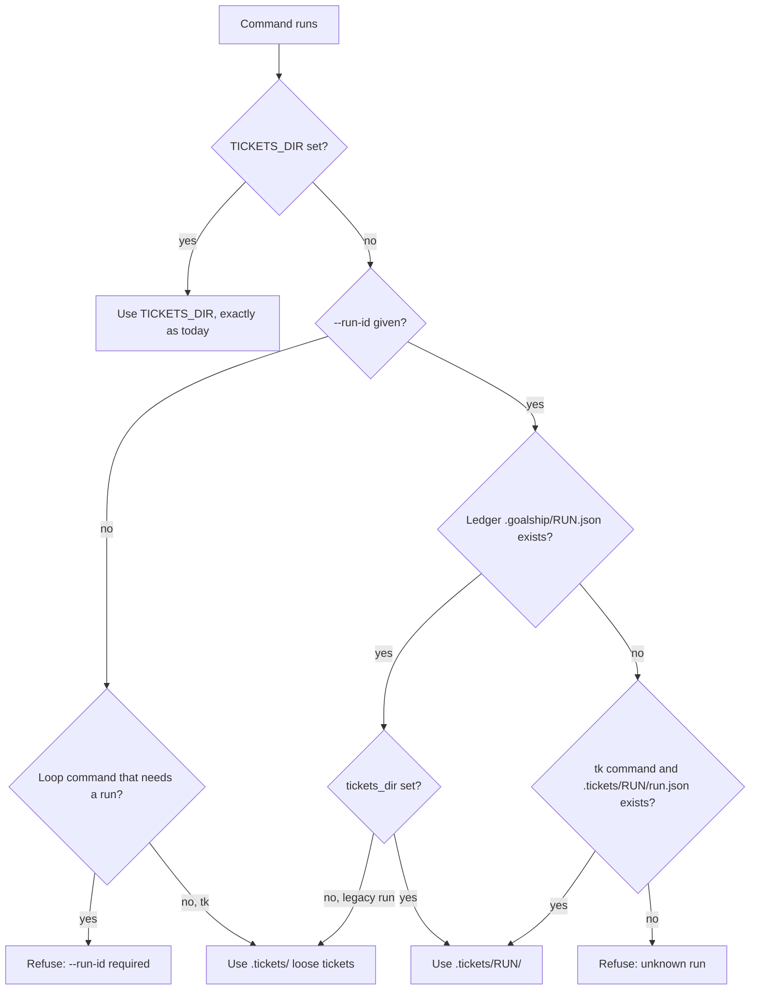

# Per-Run Ticket Folders - Plan

## Goal Capsule

- **Objective:** In a repo that has hosted many goalship runs, the developer, the orchestrating agent, and anyone browsing the repo can see one run's tickets on their own and can tell how many runs there have been, without older goals cluttering the review page, terminal listings, the repo tree, or the agent's context.
- **Means:** Each run's tickets live in `.tickets/<run-id>/`, named with `--run-id` and resolved through the run's ledger (KTD1, KTD2, KTD3).
- **Product authority:** The repo owner, through the brainstorm and planning dialogue for GitHub issue #8. The Product Contract wins on behavior; the Key Technical Decisions win on mechanism.
- **Execution profile:** Strict TDD, as `CLAUDE.md` requires: a failing test before each behavior change. Units land in dependency order.
- **Stop conditions:** Stop and ask if any change would alter the ticket file format (R2), stage or clean files under `.tickets/` (R7), or change the byte-for-byte Python prefix of the ledger JSON.
- **Who finishes:** `ce-work` implements and verifies locally; the developer reviews and merges. The sibling skill change is tracked separately (Scope Boundaries).
- **Open blockers:** None.

---

## Product Contract

### Summary

Each new goalship run keeps its tickets in its own folder inside `.tickets/`, named by run ID, with a summary file giving the run's goal, start date, and outcome.
The review page and loop commands work on that folder only, and `goalship tk` shows the current run unless asked for all runs.
Goalship never commits run folders; the orchestrating skill decides when and how a run's folder reaches git.

### Problem Frame

Goalship writes every run's tickets into one flat `.tickets/` folder.
After a few runs that folder becomes a long list that mixes goals.
The review page shows every past ticket next to the ones being approved, and approving records all of them.
`tk ls` and `tk ready` mix finished goals with the current one.
On GitHub the folder is a pile of files with no grouping.
The agent reads earlier goals' tickets and wastes context on them.
Nobody can tell how many runs a repo has had or which tickets belong together.

Today's only escape is setting `TICKETS_DIR` by hand for each run.
Nothing does that automatically, and a hand-picked location is not tied to the run's ledger.

### Actors

- A1. Developer: starts runs, approves ticket graphs on the review page, and uses `goalship tk` in a terminal.
- A2. Orchestrating agent: the goalship skill driving `goalship tk` and `goalship loop` step by step during a run.
- A3. Repo reader: anyone browsing the repo or GitHub later, wanting to see past runs and what each was for.

### Key Decisions

- **Run folders live inside `.tickets/`, where they can be versioned.** Repo readers see past runs only if the folders can be committed, and `.goalship/` is excluded from git. (session-settled: user-approved — chosen over the issue's `.goalship/<run-id>/tickets/`: that location is git-excluded, so tickets would vanish from history and GitHub.) Governs R1, R3.
- **Each folder carries a summary file and keeps the run ID as its name.** A readable name would freeze a goal wording at creation, while a summary file can record the outcome later. (session-settled: user-approved — chosen over goal-slug folder names and bare run IDs.) Governs R3.
- **`goalship tk` defaults to the selected run.** Listing everything by default recreates the clutter this work removes. (session-settled: user-approved — chosen over always listing every run grouped, and over listing only loose tickets.) Governs R8, R9, R10.
- **Existing loose tickets and older runs are left alone.** The ledgers record only claimed tickets, so any automatic move would be partial. (session-settled: user-approved — chosen over a one-time partial move and over sweeping everything into an archive folder.) Governs R14.
- **Goalship never commits run folders; the orchestrating skill owns that.** A goalship-driven run-end PR would delete the local folder on the branch switch, break resuming a merged run, and need rules for failed, closed and squash-merged PRs; the skill can choose a commit strategy without goalship hard-coding one. (session-settled: user-directed — chosen over a goalship-opened run-end PR, which research showed needed post-merge, retry and resume rules roughly doubling the work.) Governs R7, R12.
- **Dependencies stay inside one run.** Loose tickets are earlier work, and reaching across folders would make every ticket reader look in two places. (session-settled: user-directed — chosen over allowing run tickets to depend on loose tickets.) Governs R11.
- **Which run a ticket belongs to is recorded only by its folder.** Ticket files keep bash-tk byte compatibility, so no run field is added. Governs R2.

### Requirements

**Run folders**

- R1. Every run started after this change keeps its tickets in its own folder inside the repo's tickets area, named by the run's ID.
- R2. Ticket files inside a run folder use exactly today's format, with no run field.
- R3. Each run folder holds a summary file with the run's goal and start date, and the run's final outcome once it ends.

**Run-aware surfaces**

- R4. The review page for a run shows and edits only that run's tickets, and approving records only those tickets as approved.
- R5. Every loop command that reads or writes tickets for a run uses that run's folder.
- R6. An explicitly set `TICKETS_DIR` overrides the run's folder everywhere.
- R7. Run folders stay out of feature-branch commits and are never removed by a reset, as `.tickets/` is today.

**Standalone `goalship tk`**

- R8. With a run selected, every `goalship tk` command works inside that run's folder, including creating tickets.
- R9. With no run selected, `goalship tk` works on the loose tickets directly in `.tickets/`, exactly as today.
- R10. An "all runs" option lists every run's tickets grouped under their run, plus the loose tickets, so the number of runs is visible.
- R11. A run's tickets can depend on or link to tickets in the same run only; adding a dependency or link across runs, or between a run and the loose tickets, is refused.

**Run end**

- R12. Goalship never stages or commits a run folder itself; when a run reaches a terminal state it records the outcome in the summary file and leaves the folder in the working tree for the skill to handle.

**Compatibility**

- R14. Loose tickets already in `.tickets/` stay where they are, and runs whose ledgers predate this change keep using the loose tickets.

### Key Flows

- F1. A run from start to finish
  - **Trigger:** A1 hands a goal to A2.
  - **Actors:** A1, A2, A3
  - **Steps:** A2 starts a run and its folder and summary file are created; A2 creates the run's tickets with the run selected; A1 reviews and approves only that run's tickets; A2 claims, implements, and ships tickets from the run's folder; the run reaches a terminal state; goalship records the outcome in the summary file; the skill commits the folder in whatever way it chooses; A3 later sees the run as one folder with its summary.
  - **Covered by:** R1, R3, R4, R5, R8, R12

### Acceptance Examples

- AE1. **Covers R4.** Given a repo with loose tickets and two earlier run folders, when A1 opens the review page for a new run, then only the new run's tickets appear and approving records only their IDs.
- AE2. **Covers R6.** Given `TICKETS_DIR` points to a folder of the user's choosing, when a run-aware command runs, then it uses that folder, not the run's folder.
- AE3. **Covers R9, R10.** Given three run folders and some loose tickets, when A1 runs `goalship tk ls` with no run selected, then only the loose tickets appear; with the all-runs option, all three runs appear, each under its own heading, plus the loose tickets.
- AE4. **Covers R14.** Given a run whose ledger was created before this change, when A2 resumes it, then its commands keep reading and writing the loose tickets.
- AE5. **Covers R7, R12.** Given a run that just reached `exhausted`, when the terminal state is recorded, then the summary file shows `exhausted`, the run folder is still present and uncommitted, and no branch, commit or PR was created by goalship.
- AE6. **Covers R11.** Given tickets in runs A and B and some loose tickets, when someone adds a dependency from a run-B ticket to a run-A ticket or to a loose ticket, then the command refuses and nothing is written.

### Success Criteria

- On the review page, in `tk ls`, and in the agent's ticket reads, a second run in the same repo never shows the first run's tickets unless asked.
- Once a run's folder is committed, someone browsing the repo on GitHub can count the runs and read each run's goal and outcome without running goalship.

### Scope Boundaries

- Moving or migrating existing loose tickets into run folders.
- Adding a run field, or any other change, to the ticket file format.
- Any goalship-driven commit, branch, or PR for run folders.
- Approval checks on ticket contents, and handling tickets added after approval. These are the open findings recorded in `docs/plans/2026-08-27-2010-feat-goalship-cli-plan.md`, and this work does not change them.
- A dedicated command for listing runs. The all-runs option and the folder structure cover visibility.
- Considered and not built:
  - A guard that refuses to approve an empty run folder. A skill that forgets `--run-id` on `tk create` gets an empty review page and every `loop claim` then fails loudly, so the mistake surfaces at once. Revisit if the sibling skill shows the empty-approval path in practice.
  - A duplicate-ID check across all run folders. A collision needs the same minute and the same four random characters; revisit if one is ever observed.
  - `--all` on `tk ready`, `blocked` and `closed`. R10 needs one all-runs listing, which `tk ls --all` provides, and `--run-id` already scopes those commands; add them if someone asks to triage across runs.
  - A `GOALSHIP_RUN_ID` environment variable. It does not survive the agent's separate shell calls, and a misspelled name falls back to loose tickets silently (KTD2).
  - Protecting tracked ticket edits from reset's `git reset --hard`. That already applies to tracked loose tickets today and only reaches run folders once the skill commits them; the skill issue carries it.

#### Deferred to Follow-Up Work

- The sibling skill in `agent-extentions`: move onto the `goalship` binary, mint the run before decomposing, pass `--run-id` on every ticket call, and decide how run folders reach git. Tracked in Christophe1997/agent-extentions#10.

### Dependencies / Assumptions

- Ticket IDs from different run folders are assumed not to collide. Generated IDs carry a minute timestamp and a random suffix, but today's duplicate check looks only inside one folder.
- Until the sibling goalship skill passes the run through (Christophe1997/agent-extentions#10), runs driven by that skill keep producing loose tickets.
- The Python `run_state.py` drops unknown ledger keys on save. A run whose ledger is touched by the old Python loop after this change loses its folder field and falls back to loose tickets; the skill's move to the `goalship` binary removes that path.

### Sources / Research

- GitHub issue #8 and its comment on PR #25: the issue's original proposal and what PRs #25 and #26 already shipped.
- `internal/ticket/id.go`: `ResolveTicketsDir` and `RelativeTicketsDir`, which today return either `TICKETS_DIR` or `<repo>/.tickets` and have no run awareness.
- `internal/cli/tk/ticketsdir.go`: `goalship tk`'s walk-up lookup of `.tickets/`.
- `internal/ticket/query.go` and `internal/reviewserver/api.go`: ticket listings read only `*.md` files directly in the folder, not subfolders.
- `internal/reviewserver/api.go`: approval records exactly the listed ticket IDs.
- `internal/gitops/commit.go`, `internal/gitops/reset.go`, `internal/cli/loop/dirty.go`: how the tickets folder is kept out of commits, resets, and dirty-tree checks.
- `internal/ledger/state.go`, `internal/ledger/exclude.go`: ledger fields (no tickets-folder field; unknown fields are kept) and the `.goalship/` git exclusion.
- `internal/cli/loop/claim.go`, `internal/cli/loop/ledger.go`, `internal/cli/review.go`: the only commands that take a run ID today.
- `docs/plans/2026-08-27-2010-feat-goalship-cli-plan.md`: Scope Boundaries and R16, which deferred run-scoping the ticket store. Run folders close the gap R16 named: a run's approved IDs now come from that run's folder alone.
- `docs/plans/2026-09-28-1858-refactor-drop-bash-tk-dependency-plan.md`: its KTD4 (gitops resolves tickets through `ticket.ResolveTicketsDir(repoRoot)`) is superseded for run-scoped reads by KTD1 here; its KTD2 (single-ticket writes go through `ticket.Update`) and KTD3 (notes read from the raw file) still hold.

Product Contract preservation: changed during planning, with the user — R12 rewritten (goalship no longer opens a run-end PR), R13 removed, R11 narrowed to same-run dependencies only; Key Decisions, F1 and AE5/AE6 updated to match.

---

## Planning Contract

### Key Technical Decisions

- KTD1. **Split the tickets area from the active folder.** `ticket.ResolveTicketsDir` keeps meaning the tickets area (`TICKETS_DIR`, else `<repo>/.tickets`), and `RelativeTicketsDir` keeps driving the commit, reset and dirty exclusions from it. Only ticket reads and writes move to the run's folder. If the exclusions followed the run folder, `git add` would stage other runs' folders and the loose tickets into every ticket PR, and `git clean` would delete them on a gate failure. Governs R7.
- KTD2. **A run is named with a per-command `--run-id` flag.** It goes on every `goalship tk` command and on every loop command that reads or writes tickets (`claim`, `ship`, `reconcile`, `resolve-base`, `run-branch`). It is required on those loop commands and optional on `tk`. There is no persistent flag on the `tk`/`loop` parents, because every command test builds the command with `NewXCmd()` directly, and there is no environment variable (Scope Boundaries). The required flag departs from `loop_runner.py`'s argument surface, which costs nothing now because the skill does not call `goalship loop` yet. (session-settled: user-approved — chosen over an environment variable and over inferring the run from the ledger: env does not persist across the agent's shell calls, and several runs can be resumable at once.) Governs R5, R8, R9.
- KTD3. **The run's folder is recorded in its ledger as `tickets_dir`.** It is a nullable string holding the repo-relative path (`.tickets/<run-id>`), appended after the review-state fields so the Python field prefix stays byte-identical. `loop ledger` sets it only when it creates a brand-new ledger (checked by stat, as `loadExistingRunState` in `internal/cli/review.go` does) and only when `TICKETS_DIR` is unset. No flag can set it. A null or absent value marks a legacy run, which keeps using the tickets area directly. Governs R1, R6, R14.
- KTD4. **Run-aware commands refuse an unknown run.** They never call `ledger.LoadRunState` on a missing file, which would silently mint an empty run for a typo. `tk` additionally accepts a run folder that has a summary file but no ledger, so a fresh clone can still read and edit committed runs; loop commands and review require the ledger. Run IDs used as folder names go through the same sanitizing as `ledger.ResolveLedgerPath` (which turns `/` into `_`), and an ID that is exactly `.` or `..` after sanitizing is refused. Governs R5, R8.
- KTD5. **The summary file is `run.json` inside the run folder.** It is not a `.md` file, so no ticket listing, lookup, approval or bash tk glob ever sees it. It holds `run_id`, `goal`, `started_at` (set once, at creation) and `outcome` (null until terminal). `loop ledger` rewrites it atomically after every save of a run that has `tickets_dir`, preserving `started_at`. A directory under `.tickets/` counts as a run folder only if it contains `run.json`. (session-settled: user-approved — chosen over a `README.md`-style summary, which every reader would have to exclude.) Governs R3, R10, R12.
- KTD6. **Ticket ID prefixes come from the tickets area, not the active folder.** `GenerateID` currently derives the prefix from the folder's parent, so a ticket created in `.tickets/<run>/` gets the hidden ID `.ti-…` (reproduced). The prefix source becomes the tickets area's parent, which is unchanged for loose tickets and for `TICKETS_DIR`. Governs R2.
- KTD7. **Cross-run links are refused at write time.** When `tk dep`, `tk link` or `tk create --parent` cannot resolve the target in the active folder, it looks in the other run folders and the loose area; if the ID lives there, the command refuses and names where it lives, and otherwise it keeps bash tk's "not found" error. Readers stay single-folder, as R11 allows. Governs R11.
- KTD8. **Command scope is per command.** Run-scoped: every `tk` command with `--run-id`, `claim`, `ship`, `reconcile`, `resolve-base`, `run-branch`, `review`. All folders: `sweep-branches`, which only deletes branches named in ticket notes, so reading fewer folders would silently stop sweeping earlier runs. Area-root only: `commit`, `reset`, `dirty` (KTD1). gitops functions take the folder (or folder list) as a parameter instead of deriving it from `repoRoot`. Governs R5, R7.
- KTD9. **`tk ls --all` groups by folder.** Only `ls` takes `--all`, which is what R10 asks for: loose tickets first, then each run folder in run-ID order under a heading line naming the run ID and its goal from `run.json`. Each folder is listed with today's `ls` line format. Governs R10.
- KTD10. **Review gets its folder from the CLI.** `goalship review` and `review-status` already load the ledger before starting; the CLI resolves the folder and passes it to the server through `reviewserver.Options`, so the list, edit and approve paths all use the run folder; the live-refresh watcher is unchanged, because it watches only the run's ledger. Governs R4.

### High-Level Technical Design

How a command finds its tickets folder (KTD1–KTD4):

Which folder each surface uses (KTD8):

| Surface | Folder |
| --- | --- |
| `tk *` with `--run-id`, `loop claim/ship/reconcile/resolve-base/run-branch`, `review`, `review-status` | The run's folder, per the flowchart |
| `tk *` without `--run-id` | Loose tickets, as today |
| `tk ls --all` | Loose tickets, then every run folder, grouped |
| `loop sweep-branches` | Loose tickets and every run folder |
| `loop commit/reset/dirty` | Exclusion of the whole tickets area, as today |

### Assumptions

- The sibling skill will create the run (`loop ledger --goal …`) before decomposing. Tickets created before the run exists land in the loose area. This is recorded in Christophe1997/agent-extentions#10.

---

## Implementation Units

### U1. Tickets area, run folders, and summary file in `internal/ticket`

- **Goal:** Give `internal/ticket` the primitives every caller needs: the run folder path for a run ID, the run-folder listing, the `run.json` read/write, and a correct ID prefix inside run folders.
- **Requirements:** R1, R2, R3, R10; KTD1, KTD4, KTD5, KTD6.
- **Dependencies:** None.
- **Files:** `internal/ticket/id.go`, `internal/ticket/runs.go` (new), `internal/ticket/id_test.go`, `internal/ticket/runs_test.go` (new), `internal/ticket/tickettest/tickettest.go`.
- **Approach:**
  1. Keep `ResolveTicketsDir` and `RelativeTicketsDir` meaning the tickets area (KTD1); document that in their comments.
  2. Add a run-folder path helper that sanitizes the run ID exactly like `ledger.ResolveLedgerPath` and refuses an ID that is `.` or `..` after sanitizing (KTD4).
  3. Add `run.json` read and atomic write (via `internal/atomicfile`), and a listing of run folders (subdirectories of the area that contain `run.json`), sorted by run ID.
  4. Change `GenerateID`'s prefix source to the tickets area's parent (KTD6), keeping the current result for loose tickets and `TICKETS_DIR`.
  5. Give `tickettest` a folder-taking variant so later units can create tickets in run folders.
- **Patterns to follow:** `ledger.ResolveLedgerPath` sanitizing; `internal/atomicfile` writes; existing `id_test.go` table tests.
- **Test scenarios:**
  - A ticket generated in `<repo>/.tickets/<run>/` gets the same prefix as one generated in `<repo>/.tickets/`, and the file name does not start with `.`.
  - A ticket generated under `TICKETS_DIR=<tmp>/x` keeps today's prefix.
  - The run-folder path for `.` and `..` is refused; `../evil` maps to `.tickets/.._evil`, which stays inside the tickets area.
  - `run.json` round-trips `run_id`, `goal`, `started_at`, `outcome`; a rewrite with a new outcome keeps `started_at`.
  - The run-folder listing returns only subdirectories containing `run.json`, sorted, and ignores loose `.md` files and plain subdirectories.
  - `RelativeTicketsDir` still returns `.tickets` when run folders exist beneath it.
- **Verification:** `internal/ticket` tests pass and no existing `id_test.go` expectation changes.

### U2. Ledger `tickets_dir` field and run creation in `loop ledger`

- **Goal:** New runs get a recorded folder and a `run.json` at creation; terminal and goal changes are reflected in `run.json`; legacy ledgers stay legacy.
- **Requirements:** R1, R3, R6, R12, R14; KTD3, KTD5.
- **Dependencies:** U1.
- **Files:** `internal/ledger/state.go`, `internal/ledger/state_test.go`, `internal/cli/loop/ledger.go`, `internal/cli/loop/ledger_test.go`.
- **Approach:**
  1. Add `TicketsDir *string` with JSON key `tickets_dir`, emitted after the review-state fields; update the suffix fixture test, keep the Python-prefix and live-fixture tests unchanged.
  2. In `loop ledger`, stat the ledger before loading. When it does not exist and `TICKETS_DIR` is unset, set `tickets_dir`, create the folder, and write `run.json` with `started_at` now.
  3. After every save of a ledger whose `tickets_dir` is set, rewrite `run.json` from the ledger's `goal` and `terminal_state`.
  4. Do not stage, commit or otherwise touch git for the folder (R12).
- **Patterns to follow:** existing `*string` optional fields (`TicketMode`, `TerminalState`); `loadExistingRunState` stat-first check in `internal/cli/review.go`; `TestLedgerCmd_NoFlagCanSetReviewGateFields` for the no-flag guarantee.
- **Test scenarios:**
  - A first `loop ledger --goal G` call creates the ledger with `tickets_dir: ".tickets/<id>"`, the folder, and a `run.json` with goal G, a `started_at`, and null outcome.
  - A later `loop ledger --run-id <id> --goal G2` updates `run.json`'s goal and keeps `started_at`.
  - Covers AE5. `loop ledger --run-id <id> --terminal exhausted` sets `run.json` outcome to `exhausted`; `git status` shows the folder untracked and no new branch or commit exists.
  - Covers AE4. An existing ledger without `tickets_dir`, touched by `loop ledger`, still has a null `tickets_dir` and no folder is created.
  - With `TICKETS_DIR` set, a new run gets a null `tickets_dir` and no folder.
  - A ledger written with `tickets_dir` round-trips byte-identically, and the eight Python fields stay first and in order.
  - No `loop ledger` flag can set `tickets_dir`.
- **Verification:** ledger and loop ledger tests pass; the live-fixture tests over `.goalship/*.json` still pass unchanged.

### U3. Run resolution shared by `tk`, loop and review

- **Goal:** One function answers "which tickets folder does this command use for this run", implementing the flowchart in the High-Level Technical Design.
- **Requirements:** R5, R6, R8, R9, R14; KTD2, KTD3, KTD4.
- **Dependencies:** U1, U2.
- **Files:** `internal/runfolder/runfolder.go` (new), `internal/runfolder/runfolder_test.go` (new).
- **Approach:** A new small package that imports `internal/ticket` and `internal/ledger` (neither imports the other today, so it avoids a cycle). Inputs: repo root, run ID, and whether a ledger-less folder is acceptable (true for `tk`). Output: the folder to read and write, or a refusal. `TICKETS_DIR` wins first (R6). An unknown run is refused without minting a ledger (KTD4).
- **Patterns to follow:** `loadExistingRunState` in `internal/cli/review.go`; plain `fmt.Errorf` errors, per the existing error convention.
- **Test scenarios:**
  - Ledger with `tickets_dir` → that folder.
  - Covers AE4. Legacy ledger with null `tickets_dir` → the tickets area.
  - Covers AE2. `TICKETS_DIR` set → `TICKETS_DIR`, whatever the ledger says.
  - No ledger, folder with `run.json`, ledger-less allowed → the folder; ledger-less not allowed → refused.
  - No ledger and no folder → refused, and no ledger file is created.
  - Run ID `..` → refused; run ID `../x` resolves inside `.tickets/`.
- **Verification:** package tests pass; no other package changes behavior yet.

### U4. Loop commands use the run's folder

- **Goal:** `claim`, `ship`, `reconcile`, `resolve-base` and `run-branch` read and write the run's folder; `sweep-branches` reads every folder; `commit`, `reset` and `dirty` keep protecting the whole tickets area.
- **Requirements:** R5, R7; KTD1, KTD2, KTD8.
- **Dependencies:** U3.
- **Files:** `internal/cli/loop/claim.go`, `internal/cli/loop/ship.go`, `internal/cli/loop/reconcile.go`, `internal/cli/loop/resolvebase.go`, `internal/cli/loop/runbranch.go`, `internal/cli/loop/sweepbranches.go`, `internal/gitops/notes.go`, `internal/gitops/reconcile.go`, `internal/gitops/resolvebase.go`, `internal/gitops/runbranch.go`, `internal/gitops/sweepbranches.go`. Tests: the matching `internal/gitops/*_test.go` files, `internal/gitops/reset_test.go`, `internal/gitops/commit_test.go`, `internal/cli/loop/claim_test.go`, `internal/cli/loop/branch_test.go` (resolve-base, run-branch), `internal/cli/loop/commitpr_test.go` (ship), `internal/cli/loop/reconcile_test.go`, `internal/cli/loop/sweepbranches_test.go`, `internal/cli/loop/dirty_test.go`, `internal/cli/loop/args_test.go`.
- **Approach:**
  1. Thread a tickets-folder parameter through `queryTickets`, `readNotes`, `noteFieldsForTicket`, `recordOutcome`, `Reconcile`, `ResolveBase`, `RunBranch`; `SweepBranches` takes the list of folders (area plus every run folder from U1).
  2. Add required `--run-id` to `ship`, `reconcile`, `resolve-base`, `run-branch`; `claim` already has it and switches its note write to the resolved folder.
  3. Leave `CommitAll`, `Reset` and `ignoredDirtyDirNames` on `RelativeTicketsDir`, and add regression tests proving other runs' folders and loose tickets survive.
- **Execution note:** Write the reset and commit regression tests first; they guard the data-loss path KTD1 exists for.
- **Patterns to follow:** `newTestRepo` in `internal/gitops/helpers_test.go`; `claimTestSetup` and `saveRunState` in `internal/cli/loop/claim_test.go`; `TICKETS_DIR` override tests in `claim_test.go`, `commitpr_test.go`, `dirty_test.go`.
- **Test scenarios:**
  - `loop reset` on a repo with an untracked run folder for run A, another for run B and untracked loose tickets leaves all three in place.
  - `loop commit` with the same layout stages none of `.tickets/`.
  - `loop dirty` with only run-folder changes reports clean.
  - `loop claim --run-id A` writes the claim note into `.tickets/A/<id>.md` and leaves a same-titled loose ticket untouched.
  - `loop ship --run-id A …` closes the ticket in run A's folder.
  - `loop reconcile --run-id A` reports only run A's in-progress tickets.
  - `loop resolve-base --run-id A` reads dependency notes from run A's folder.
  - `loop sweep-branches` considers a merged branch named only in an old run folder's notes.
  - Each run-scoped loop command without `--run-id` exits non-zero with a message naming the flag; with an unknown run it exits non-zero and creates no ledger.
  - Covers AE4. A legacy run's `loop ship --run-id L` writes the loose ticket.
- **Verification:** loop and gitops tests pass, including the existing `TICKETS_DIR` override tests.

### U5. `goalship tk` run selection

- **Goal:** Every `tk` command accepts `--run-id` and works inside that run's folder; without it, behavior is byte-identical to today.
- **Requirements:** R8, R9, R2; KTD2, KTD4.
- **Dependencies:** U3.
- **Files:** `internal/cli/tk/ticketsdir.go`, every `internal/cli/tk/*.go` command file that calls `findTicketsDir`/`findOrInitTicketsDir`, `internal/cli/tk/ticketsdir_test.go`, `internal/cli/tk/create_test.go`, `internal/cli/tk/ls_test.go`.
- **Approach:**
  1. Add a run-aware locate step: walk up to the tickets area as today, take its parent as the repo root, then resolve through U3 with ledger-less folders allowed.
  2. Register `--run-id` on each command and route it through that step; commands without the flag call today's path unchanged.
  3. `tk create --run-id` writes into the run folder and creates it if the ledger names it but it is missing.
- **Patterns to follow:** `NewXCmd()` command tests with `SetArgs`/`SetOut`; `chdir`-based walk-up tests in `ticketsdir_test.go`.
- **Test scenarios:**
  - `tk create --run-id A "x"` creates `.tickets/A/<prefix>-….md` with a non-hidden name and today's file format.
  - `tk ls --run-id A` lists only run A's tickets; `tk ls` lists only loose tickets.
  - `tk ready --run-id A` and `tk blocked --run-id A` evaluate dependencies within run A.
  - `tk show --run-id A <id>` finds the ticket; `tk show <id>` without the flag reports bash tk's not-found error.
  - `tk ls --run-id B` for a ledger-less folder with `run.json` works; for an unknown run it fails and creates nothing.
  - With `TICKETS_DIR` set, `--run-id` is ignored and the override is used (AE2).
- **Verification:** all `internal/cli/tk` tests pass, existing output expectations unchanged.

### U6. Cross-run refusal and `--all` listings

- **Goal:** Links never cross runs, and `tk ls --all` shows every run grouped.
- **Requirements:** R10, R11; KTD7, KTD9.
- **Dependencies:** U5.
- **Files:** `internal/cli/tk/dep.go`, `internal/cli/tk/link.go`, `internal/cli/tk/create.go`, `internal/cli/tk/ls.go`, with `dep_test.go`, `link_test.go`, `create_test.go`, `ls_test.go`.
- **Approach:**
  1. On a target miss in the active folder, search the other run folders and the loose area; refuse with the owning location if found (KTD7).
  2. Extract `ls`'s per-line formatter so `--all` can print loose tickets, then one heading per run folder followed by that folder's lines (KTD9).
- **Test scenarios:**
  - Covers AE6. `tk dep --run-id B b1 a1` where `a1` is in run A refuses, names run A, and leaves `b1` unchanged.
  - Covers AE6. `tk dep --run-id B b1 l1` where `l1` is loose refuses and names the loose area.
  - `tk dep l1 b1` from loose to a run ticket refuses.
  - `tk link` and `tk create --parent` follow the same refusals.
  - A target that exists nowhere keeps bash tk's not-found message.
  - Covers AE3. `tk ls --all` with three run folders and loose tickets prints loose tickets, then three headings with each run's ID and goal, each followed by only that run's tickets.
- **Verification:** tk tests pass; output without `--all` is unchanged.

### U7. Review scoped to the run

- **Goal:** The review page lists, edits and approves only the run's folder.
- **Requirements:** R4; KTD10.
- **Dependencies:** U3.
- **Files:** `internal/cli/review.go`, `internal/cli/review_test.go`, `internal/reviewserver/server.go`, `internal/reviewserver/api_test.go`.
- **Approach:** The CLI resolves the folder with U3 (ledger required) and passes it through `reviewserver.Options`; `server.go` uses it instead of calling `ticket.ResolveTicketsDir`.
- **Patterns to follow:** the existing `TICKETS_DIR` pin in `internal/reviewserver/api_test.go`.
- **Test scenarios:**
  - Covers AE1. With loose tickets and two earlier run folders, `GET /api/tickets` for the new run returns only its tickets, and approve records exactly those IDs.
  - A PATCH for a ticket ID that exists only in another run returns not-found.
  - A legacy run's review lists the loose tickets.
- **Verification:** reviewserver and CLI review tests pass.

### U8. Documentation

- **Goal:** Users and future agents know how run folders work.
- **Requirements:** R1, R3, R8, R10, R12.
- **Dependencies:** U2, U5, U6.
- **Files:** `README.md`, `CLAUDE.md`.
- **Approach:** README: describe `.tickets/<run-id>/`, `run.json`, `--run-id`, `--all`, and that goalship never commits run folders. CLAUDE.md: replace the "every run shares one `.tickets/`" note with the area-versus-folder rule (KTD1) and the `internal/runfolder` package.
- **Test expectation:** none -- documentation only.
- **Verification:** README examples match the commands' `--help` output.

---

## Verification Contract

| Gate | Command | Applies to |
| --- | --- | --- |
| Build | `go build ./...` | Every unit |
| Vet | `go vet ./...` | Every unit |
| Format | `gofmt -l .` prints nothing | Every unit |
| Tests | `go test -race ./...` | Every unit; CI runs the same on Ubuntu |
| Focused | `go test ./internal/<pkg> -run <TestName> -v` | While iterating on a unit |

The two host-tool timeout tests tracked in issue #29 are known to be timing-sensitive; a failure there alone is not a regression from this work.

---

## Definition of Done

- Every unit's test scenarios exist and pass, written before the behavior they cover.
- All gates in the Verification Contract pass locally.
- AE1–AE6 each have at least one passing test that names them.
- Output of every `tk` command without `--run-id` or `--all` is unchanged, except that `dep`, `link` and `create --parent` refuse targets that live in a run folder (U6); ticket files stay byte-compatible with bash tk.
- No code path stages, commits, branches or opens a PR for anything under `.tickets/`.
- README and CLAUDE.md describe run folders.
- No dead or experimental code from abandoned approaches remains in the diff.
